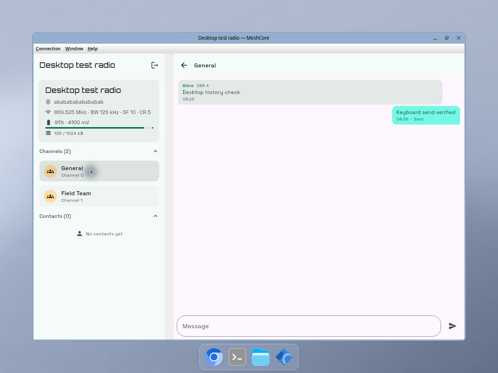
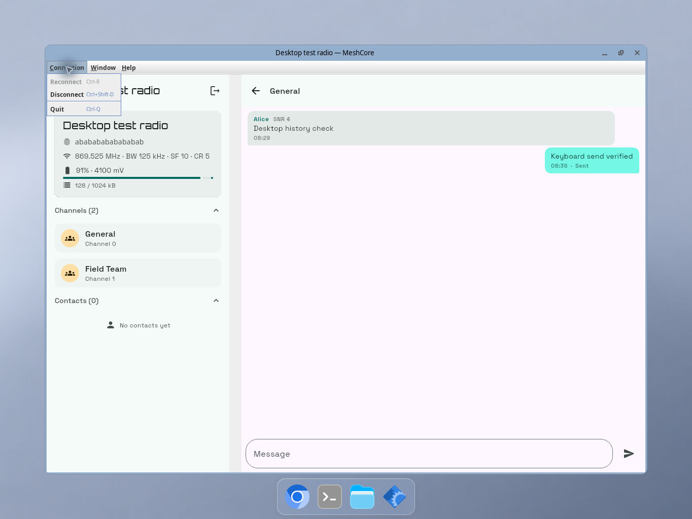
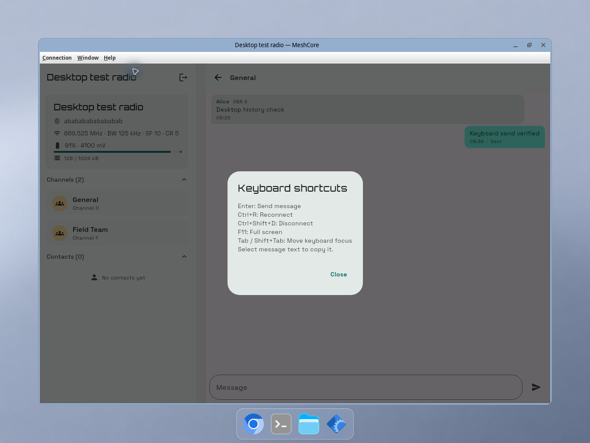

# MeshCore desktop experience evidence

Captured from the Linux JVM desktop application on 8 November 2026 at 1364 × 1024.
The app connects to a local simulated companion radio at `127.0.0.1:15000`; the radio
identity, channel names, and messages are test data. These are application screenshots,
not design mockups. No macOS or Wayland visual verification is claimed.

## Conversation after reconnect

A received message and a message submitted with Enter remain visible after disconnecting
and reconnecting. The radio's echo of the outgoing message is reconciled into one bubble.
The adaptive list/detail layout already existed; this change adds the desktop shell,
keyboard interaction, and durable history around it.

## Connection commands

The desktop menu exposes reconnect, disconnect, and Quit with Linux shortcuts. Reconnect
is disabled while connected. The smoke test exercised Ctrl+Shift+D to disconnect and
Ctrl+R to reconnect to the saved endpoint.

## Discoverable keyboard shortcuts

The Help menu opens a shortcut reference. F11 full-screen entry/exit and copying selected
message text into the composer through the system clipboard were also checked manually.

## Automated validation

- `:desktop-app:jvmTest` and `:meshcore-components:desktopTest`: 16 tests passed.
- `:meshcore-components:compileAndroidMain` and `:web-app:compileKotlinWasmJs`: passed.
- `:desktop-app:ktfmtCheck`, `:meshcore-components:ktfmtCheck`, and
  `:meshcore-data:ktfmtCheck`: passed.

Tests cover a database close/reopen and TCP address change, radio/conversation isolation,
received-message deduplication, interrupted sends, preference persistence, monitor removal,
Enter repeat/blank/modified-key behavior, and channel-echo reconciliation.

The macOS menu and Dock lifecycle, Wayland window behavior, real hardware transports,
notifications, and tray integration still need separate validation or implementation.
